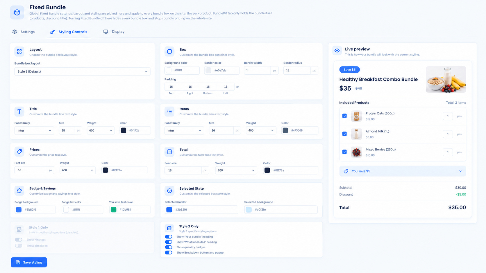
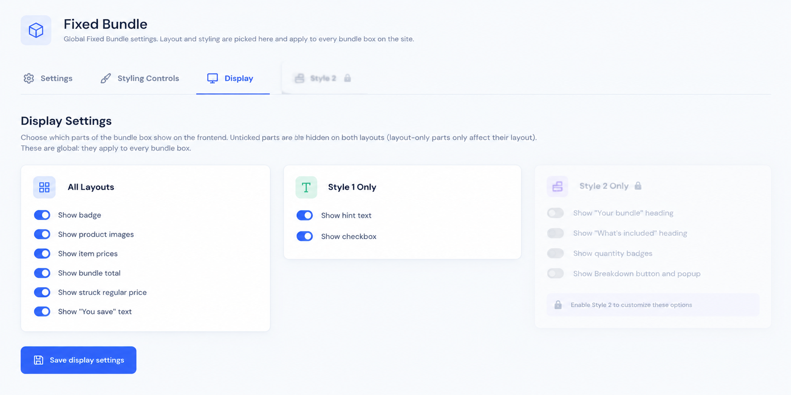

# BundleKit – Fixed Bundle

**Sell curated product bundles with a bundle box, discounts, and one cart line at the bundle total.**

Free and open source. Version 1.9.3.

   

Sell a fixed group of products as one kit — at a fixed total price or with a percentage discount. A bundle box with a clickable checkbox appears inside the product's own add-to-cart form (unchecked by default). Tick it and the whole bundle goes to the cart as **one line** at the bundle total, labelled "Bundle offer" with its "Includes" list; leave it unticked and the customer buys the single product as normal.

> There is no separate BundleKit plugin to install. The BundleKit framework is bundled inside this plugin — install and activate just this one.

## Contents

1. [What it is used for](#what-it-is-used-for)
2. [Screenshots](#screenshots)
3. [Features](#features)
4. [Installation and quick start](#installation-and-quick-start)
5. [Setting up a bundle](#setting-up-a-bundle)
6. [Cart behavior](#cart-behavior)
7. [Global settings reference](#global-settings-reference)
8. [Styling](#styling)
9. [FAQ and troubleshooting](#faq-and-troubleshooting)
10. [Version history and roadmap](#version-history-and-roadmap)
11. [Support and license](#support-and-license)

## What it is used for

| Use case | How |
|---|---|
| **Gift sets and hampers** | Group the items, set one bundle price, customers tick the box to add the whole set. |
| **Meal and combo deals** | A "breakfast combo" with a fixed total cheaper than the items bought separately. |
| **Starter kits** | Bundle the essentials for a new hobby or routine with a launch discount. |
| **B2B kits** | One order line per kit keeps invoices and packing simple. |

## Screenshots

### Admin

| | |
|---|---|
|  **Styling Controls** with live preview of the bundle box |  **Display Settings**: 12 show/hide toggles for bundle box parts |

## Features

**Storefront**
- Bundle box with a clickable checkbox inside the product's add-to-cart form; unchecked by default.
- Ticked = the whole bundle as one cart line at the bundle total, with a "Bundle offer" label and the "Includes" product list on the line.
- Savings badge, struck regular price, "You save" text and per-item prices — each toggleable in Display settings.

**Bundle setup (per product)**
- Product editor > **BundleKit** tab: bundle on/off, title, cart name, badge text, discount, and the bundled products.
- Short per-product setup — everything else is global.

**Global control**
- **BundleKit > Fixed Bundle > Settings**: master on/off kill-switch for the whole site.
- **Styling Controls**: color pickers and typography with a live preview — one style for every bundle box on the site.
- **Display**: 12 show/hide toggles for the parts of the bundle box.

**Quality**
- No external requests, tracking or telemetry. Nonce checks on settings saves; escaped output.

## Installation and quick start

1. Upload the ZIP at **Plugins > Add New Plugin > Upload Plugin** and activate (WooCommerce must be active).
2. Open a product, go to the **BundleKit** tab, switch the bundle on, add the bundled products and set the discount.
3. View the product: tick the bundle box and add to cart — the cart shows one line at the bundle total.

## Setting up a bundle

1. Edit a product > **BundleKit** tab > enable the bundle.
2. Set the **title** (shown on the box), the **cart name** (shown on the cart line), the **badge text** and the **discount**.
3. Add the bundled products, then save.

## Cart behavior

- The bundle line carries the cart name you set, a "Bundle offer" label and the "Includes" list of products.
- An unticked box — or a product with no bundle — adds the single product normally.
- Switching Fixed Bundle off in Settings hides every bundle box and stops bundle pricing site-wide.

## Global settings reference

| Tab | Controls |
|---|---|
| Settings | Master on/off kill-switch |
| Styling Controls | Layout style, box, title, items, prices, total, badge & savings, selected state; live preview |
| Display | 12 show/hide toggles: badge, product images, item prices, bundle total, struck regular price, "You save" text, hint text, checkbox, and layout-specific parts |

## Styling

Styling and layout are **global only**: what you pick under Styling Controls applies to every bundle box on the site. The product editor holds just the bundle content, so per-product setup stays short and every bundle matches your theme.

## FAQ and troubleshooting

**The bundle box does not appear on the product page.** Check that the bundle is enabled on the product's BundleKit tab, and that Fixed Bundle is switched on under BundleKit > Fixed Bundle > Settings.

**I updated the plugin but the old version still seems to run.** Check the version on the Plugins screen. If the files did not actually replace, re-upload the ZIP with "Replace current with uploaded", restart Apache (to clear OPcache), and in Elementor go to Tools > Regenerate Files & Data.

**Can I style each bundle differently?** No — styling is global by design, so every bundle box on the site looks consistent.

## Version history and roadmap

| Version | Highlights |
|---|---|
| **1.9.3** | WordPress.org submission build: brand-free code and readme |
| **1.9.2** | Readme fix: short description placement for the .org parser |
| **1.9.1** | WordPress.org review cleanup |
| **1.9.0** | Admin redesign: Settings / Styling Controls / Display with live preview |
| **1.8.1** | Fix: fatal when two BundleKit add-ons are active together |
| **1.0.0** | Initial release: bundle box, one-line cart, per-product setup |

**Roadmap:** more BundleKit add-ons (Mix-and-match / BYOB, Build-a-box).

## Support and license

Ideas and bug reports: open a GitHub issue, or email **safiqkhan0102@gmail.com**. Author: Shafiqur Rehman.

MIT. See `LICENSE`. (The plugin header also carries `GPLv2 or later` for WordPress.org compatibility.)
